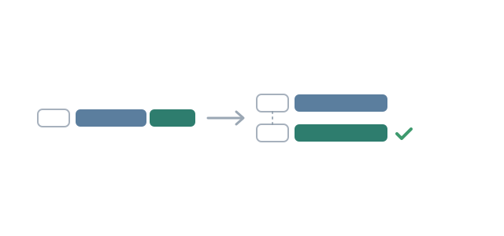

# 日语歌词匹配 · Nihongo Lyrics Match


[](LICENSE)

把中文音乐软件常见的「日文原文 + 空格 + 中文翻译」混排歌词，拆成**时间戳完全一致**的两行，保存原始歌词到集中 LRC 备份，并在转换后自动生成一份**可交互的 HTML 报告**。

同一个仓库同时提供：

- **DSH 插件**（`dsh-nihongo-lyrics-match`）：`lyrics_convert` / `lyrics_review` / `lyrics_report` / `lyrics_revert` 四个工具；**不提供设置页**，交互通过工具和 HTML 报告完成。
- **CLI**（`lyrics-split`）：不依赖 DSH，直接对目录批量运行。

```text
[00:28.70]春空に残る淋しさ そっと心を濡らした 春雨后留下的空寂轻轻沾湿心田
```

变成：

```text
[00:28.70]春空に残る淋しさ そっと心を濡らした
[00:28.70]春雨后留下的空寂轻轻沾湿心田
```



## 功能

- **格式**：WAV（RIFF `id3 ` → ID3v2.3/2.4 `USLT`）、MP3（ID3v2 `USLT`）、FLAC（`VORBIS_COMMENT` 的 `LYRICS` / `UNSYNCEDLYRICS` 等）、独立 `.lrc`（保留 UTF-8/UTF-16、BOM、换行）。
- **括号译文**：`〖...〗`（以及 `（...）`、`【...】` 等）包裹的整段译文即使中间有空格，也会在开括号前整体拆到中文行，不会把译文前半截留在日文行里。
- **只改歌词**：WAV/MP3/FLAC 写入后逐字节校验，除歌词标签外音频、封面、其它元数据不变。
- **默认预览**：不加 `apply` 不写任何文件。
- **幂等**：已拆好的行、纯日文歌词会被识别并跳过。
- **集中备份**：不复制音频；原始歌词保存到 `<歌曲库>/.lyrics-backup/`，内部保持原专辑目录层级。
- **转换后自动报告（DSH 插件）**：默认在库根写 `lyrics-review-report.html`；先给出总数和已转换 / 无需转换 / 无歌词，再单独标出「其中需要复核」的内容异常歌曲（不重复相加），点进歌曲看具体异常行。CLI 仍用 `--json` 输出结构化报告。

## 直接安装（DSH）

仓库根目录就是可安装的 DSH bundle，不需要再进子目录。

### Plugin Manager

**Plugins → Add plugin**，粘贴：

```text
https://github.com/2744317644/nihongo-lyrics-match
```

### 或让 agent 安装

```text
plugin_manager install_bundle({
  target: "github:2744317644/nihongo-lyrics-match"
})
```

如果当前 DSH 版本对 Git 仓库探测有网络限制，也可以用：

```text
plugin_manager install_bundle({
  target: "git+https://github.com/2744317644/nihongo-lyrics-match.git"
})
```

安装后打开新会话即可看到 `lyrics_convert`、`lyrics_review`、`lyrics_report`、`lyrics_revert` 四个工具；插件没有设置页，转换后打开的 HTML 报告就是复核入口。

## 使用

### 1. 预览

```text
lyrics_convert({ directory: "D:\\Music\\JPOP" })
```

只报告将会改多少文件/行，不写文件。

### 2. 写入并自动生成报告

```text
lyrics_convert({ directory: "D:\\Music\\JPOP", apply: true })
```

- 每个被改写的文件先把原始歌词写入 `.lyrics-backup`，再原子写入并校验；
- 默认生成 `D:\Music\JPOP\lyrics-review-report.html`；
- 报告先显示：**全部 N 首 = 已转换 N 首 + 未转换 N 首**，并列出未转换里的无需转换/无歌词/待转换/跳过/错误；然后单独标出**其中需要复核 N 首**（内容异常，属于上面的文件，不重复相加）。四个标签为 **已转换 / 未转换 / 需要复核 / 全部歌曲**；
- 未转换列表会显示每首的行数；点进文件后可查看原始解析行。注意 **0 对只表示没有日中拆分行，不代表没有歌词**。
- 点击歌曲查看具体异常行：时间戳、日文、中文、原始混排行、拆分原因、标记；可切换“只看异常/全部行”，支持搜索和标记筛选；
- 不需要报告时传 `report: false`；预览时传 `report: true` 可生成 dry-run 报告。

### 3. 复核 / 重新生成报告

```text
lyrics_review({ directory: "D:\\Music\\JPOP", filter: "flagged", limit: 20 })
lyrics_report({ directory: "D:\\Music\\JPOP" })
lyrics_report({ directory: "D:\\Music\\JPOP", output: "D:\\Music\\JPOP\\review.html" })
```

### 4. 还原

```text
lyrics_revert({ path: "D:\\Music\\JPOP\\album\\01. 春空.flac", confirm: true })
lyrics_revert({ path: "D:\\Music\\JPOP", confirm: true })
```

还原需要 `confirm: true`；保留 LRC 备份。音频文件只改写歌词标签，音频/封面字节保持原样。

## 备份模型

```text
歌曲库/
├─ Artist/Album/song.flac
├─ Artist/Album/song.lrc
└─ .lyrics-backup/
   └─ Artist/Album/
      ├─ song.flac.lrc      ← 原始歌词文本
      └─ song.lrc           ← .lrc 源文件按原字节复制
```

- `.lyrics-backup` 是每个歌曲库一个的备份根；扫描子目录时复用最近的已存在备份根。
- 音频的备份是歌词文本，不是音频副本；`.lrc` 备份保留原编码和字节。
- 已有备份只在歌词一致时复用，绝不覆盖。
- 旧版 `<file>.bak` 仍可被复核/还原识别；迁移：

  ```powershell
  node bin/migrate-backups.js "D:\Music\JPOP"           # 预览
  node bin/migrate-backups.js "D:\Music\JPOP" --apply   # 迁移并删除旧 .bak
  ```

## CLI

```powershell
node bin/lyrics-split.js "D:\Music\JPOP"                 # 预览
node bin/lyrics-split.js "D:\Music\JPOP" --apply         # 写入并备份
node bin/lyrics-split.js "D:\Music\JPOP" --apply --json report.json
node bin/migrate-backups.js "D:\Music\JPOP" --apply
```

CLI 不写 HTML 报告；HTML 报告由 DSH 插件的 `lyrics_convert` / `lyrics_report` 生成。

## 开发

```powershell
node --test
$env:LYRICS_TEST_LIBRARY = "D:\Music\JPOP"
node --test
```

仓库结构：

```text
index.js            DSH Host 插件入口
cordis.patch.yml    DSH bundle 行
lib/                DSH 插件的拆分/复核/报告/还原引擎
bin/                CLI 入口（lyrics-split、migrate-backups）
src/                CLI 引擎
locale/             中英文显示元数据
docs/               插件详情页 + 预览图
assets/dsh-badge.svg
icon.svg            插件图标（含 DSH 角标）
test/               单元/集成测试
```

## 许可证

MIT。见 [LICENSE](LICENSE)。
