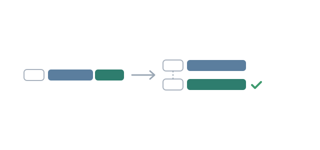

## What it does

Many Japanese songs carry a Chinese translation inside the same timed lyric line: `[00:28.70]春空に残る淋しさ そっと心を濡らした 春雨后留下的空寂轻轻沾湿心田`. The tools split such lines into two lines with identical timestamps, then review the result against the untouched original saved as an LRC backup.

- **HTML report:** an apply generates a self-contained interactive report (pass `report: false` to skip it). It starts with the total and the disjoint conversion categories (converted / not converted), with no-change, no-lyrics, pending, skipped and error files visible under the not-converted tab, then calls out the content anomalies that need review (a subset, not added again). Not-converted files keep a readable line count and a raw timed-line preview; **0 pairs means no Japanese/Chinese split pair, not no lyrics**. Clicking a song shows its flagged lines with timestamps, both lyric halves, the original line, split reasons, and flags. Use `lyrics_report` to regenerate it or choose another output. It needs no server or network and is read-only.
- **No settings page:** the plugin deliberately has no Settings UI. Use the four tools and the generated HTML report; `lyrics_revert` handles restore.
- **Bracket-quoted translations:** a trailing translation wrapped in `〖...〗` (and the other supported paired openers) stays on the Chinese side even when it contains spaces, so `〖看到了吗？ 恶作剧地问著 你却红了脸〗` is split before the opening bracket.
- **Slash delimiters:** a translation introduced by a leading `/` in the merged line (for example `…けれど /一份期待…`) is split and the delimiter slash is removed. The slash is only removed when it starts the Chinese half, the remainder has Han but no kana and no further slash; `A/B`, URLs, `好き/嫌い`, and `他/她` are left untouched.
- **Parenthetical repeats:** `ずっとそばで(ずっとそばで) 一直在身旁 （一直在身旁）` keeps the whole Japanese phrase with its parenthetical repeat on one line and the whole Chinese translation with its parenthetical repeat on the other; a bracket inside the translation does not override the first JP/ZH boundary.
- **Lyrics locations:** WAV `id3 ` chunk (ID3v2.3/2.4 `USLT`), MP3 ID3v2 `USLT`, FLAC `VORBIS_COMMENT` (`LYRICS`, `UNSYNCEDLYRICS`, and related keys), and standalone `.lrc` text. Other tags, cover art, metadata blocks, and audio bytes are never rewritten.
- **Backups:** the original lyrics are saved once as one LRC file under `<library>/.lyrics-backup`, mirroring the original folders: `Artist/Album/song.flac` → `.lyrics-backup/Artist/Album/song.flac.lrc`, and a `.lrc` source keeps its own name. Audio containers are never copied. Existing backups are never overwritten, and every conversion is idempotent.
- **Verification:** each rewritten container is rebuilt and self-checked before writing, then re-read after writing. WAV/MP3/FLAC verify that everything except the lyric tag is byte-identical.
- **Convert reasons:** `standard`, `te-form-shift`, `ratio-fallback`, `latin-start`, `latin-repeat`, `latin-after-punct`, `jp-only-residual`, and `no-kana`. Each line's decision is reported.

## Usage

```
lyrics_convert({ directory: "D:\\Music\\JPOP", apply: false })
lyrics_convert({ directory: "D:\\Music\\JPOP", apply: true, review: true })
lyrics_convert({ directory: "D:\\Music\\JPOP", apply: true, report: false })
lyrics_review({ directory: "D:\\Music\\JPOP", file: "album/01. 春空.flac", filter: "all" })
lyrics_report({ directory: "D:\\Music\\JPOP" })
lyrics_report({ directory: "D:\\Music\\JPOP", output: "D:\\Music\\JPOP\\review.html" })
lyrics_revert({ path: "D:\\Music\\JPOP\\album\\01. 春空.flac", confirm: true })
lyrics_revert({ path: "D:\\Music\\JPOP", confirm: true })
```

1. Preview: `lyrics_convert` without `apply` reports every file's status, format, changed line count, and split reasons, and writes nothing.
2. Apply: set `apply: true`. Each rewritten file gets its original lyrics saved once under `.lyrics-backup` and is verified. An HTML report is written by default (`report: false` disables it); pass `review: true` to also append a compact flagged-split summary to the tool output.
3. Review: `lyrics_review` compares each current file with the split of its LRC backup (or a legacy `.bak`) and returns the summary, per-file counts, and structured flagged lines. `filter: "all"` returns every pair; `file` narrows to one relative path; `limit` caps line entries.
4. Revert: `lyrics_revert` restores the original lyrics from the LRC backup over one file or every backed-up file under a directory. It requires `confirm: true`, verifies the result, keeps the backup, and never touches a file without a backup. For WAV/MP3/FLAC only the lyric tag is rewritten; audio and cover bytes stay unchanged.
5. Report: the apply in step 2 writes `<directory>/lyrics-review-report.html` automatically. It starts with the total and the disjoint conversion categories (converted / not converted); the not-converted tab includes no-change, no-lyrics, pending, skipped and error files. It then calls out the content anomalies that need review (a subset, not added again); click a song to see its flagged lines, reasons, and flags. `lyrics_report` regenerates the report or writes it to `output`. The report is a read-only snapshot generated from the current files and backups.

`force: true` splits lyrics that contain no Simplified-Chinese marker; without it those files are reported as `skipped-no-translation` so pure Japanese lyrics are left alone. `backup: false` disables backups and is not recommended.

Legacy full-file `<file>.bak` copies from older versions are still found by review and revert when no LRC backup exists. In the repository, `node bin/migrate-backups.js "<library>" --apply` converts them into the centralized tree and removes the migrated `.bak` files (preview by default; `--keep-bak` keeps them).

## Review flags

Each flagged pair, or file, carries zero or more of these flags. `noBackup` and `noLyrics` describe the file rather than one pair:

| Flag | Meaning |
| --- | --- |
| `jpHasChineseOnly` | The Japanese half contains a Simplified-Chinese-only character (for example 泪 used for 涙). |
| `zhHasJapaneseOnly` | The Chinese half contains a Japanese-only form (for example 変 used for 变). |
| `shortTranslation` | The Chinese half has at most 3 non-space characters and no Simplified-Chinese-only character; very short translations often mean the boundary stopped early. |
| `missingPair` | One half of the pair is missing at its timestamp in the current file. |
| `timestampMismatch` | The two halves no longer share a timestamp, or the file's timestamp sequence goes backwards. |
| `titleLine` | A `Title - Artist` line that was intentionally left unsplit; listed so it is not mistaken for a missed split. |
| `manualEdit` | The current file differs from the split of its original lyrics (edited, partially converted, or the lyric tag was removed). |
| `noBackup` | The file has lyrics but no LRC backup or legacy `.bak`, so it cannot be compared or reverted. |
| `noLyrics` | The file has no embedded lyric tag. |
| `mojibake` | U+FFFD appears in the current lyrics or the backup, so text was lost somewhere. |

A pair whose split reason is **not** `standard` is returned by the default `flagged` filter even when its flag list is empty; its `reason` explains the heuristic boundary that was used and is the intended thing to review.

## Limitations

- Boundaries are heuristics, not a translation model. Unusual wording can still be misjudged; review flags such lines instead of silently "fixing" them, and preview is always the default.
- Review pairs come from the LRC backup (or a legacy `.bak`). Files without a backup are reported with `noBackup` and have no pairs to compare.
- ID3 support is limited to ID3v2.3/2.4 `USLT` without unsynchronisation, extended headers, per-frame flags, or multiple `USLT` frames. Such files fail with a message and stay unchanged.
- FLAC lyrics must be valid UTF-8; invalid UTF-8 is refused instead of rewritten, and review reports it as `mojibake`.
- Only `.wav`, `.mp3`, `.flac`, and `.lrc` are handled. Formats such as `.m4a` are ignored.
- Preview and review read only the lyric container, so large libraries scan quickly. `apply` still loads one complete file at a time to rebuild it, so very large files take longer.
- Reverting a WAV/MP3/FLAC rewrites only the lyric tag; it is not a byte-for-byte copy of the original container. The original lyrics (the review baseline) are restored exactly, and audio/cover bytes are verified unchanged.
- An audio file whose lyric tag was removed entirely cannot be restored from its LRC backup; the revert reports an error and leaves the file untouched.
- Revert keeps the LRC backup, so it can be repeated; delete backups manually once a directory is final (or move `.lyrics-backup` away).
- `.lyrics-backup` is skipped by the scan, so backups never appear as music files. The backup root is the nearest `.lyrics-backup` at or above the scanned directory; scanning a subdirectory before the folder exists creates it in that subdirectory.
- Every path is resolved inside the directory you pass. `file` must stay inside that directory, and plain files without a backup are never touched.
- Results are bounded: at most 500 file entries per conversion or revert list, and at most 1000 line entries per review (default 100). Omission counts and a narrowing hint are returned instead of truncating silently.
- The HTML report is a static snapshot: generate it again after conversion, manual edits, or a revert. It does not restore files; use `lyrics_revert` for that.
- The report lists at most 500 songs and 1000 lines per song; the header notes omitted/truncated data. It is self-contained and requires no network access.
- There is no Settings page and no local HTTP panel API; the four tools and the report are the whole interface.
