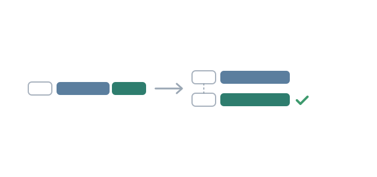

## 功能

不少日文歌把中文翻译写在同一行带时间戳的歌词里：`[00:28.70]春空に残る淋しさ そっと心を濡らした 春雨后留下的空寂轻轻沾湿心田`。这些工具会把这类行拆成时间戳完全相同的两行，再对照保存为 LRC 备份的原始歌词逐行复核。

- **HTML 报告：** 执行写入（apply）后默认自动生成一个自包含、可交互的报告（`report: false` 可关闭）。报告开头先写全部文件数，以及已转换、未转换（不用担心：无需转换、无歌词、待转换、跳过、错误都在这里）的数量；再单独标出「其中需要复核」的内容异常歌曲（不重复相加）。未转换文件会显示歌词行数，点进去可以查看原始解析行；**0 对只表示没有日中拆分行，不代表没有歌词**。点进歌曲可查看具体异常行的时间戳、日文/中文、原始行、拆分原因和标记。可再用 `lyrics_report` 重新生成或指定输出路径。无需服务器或网络，报告只读。
- **不提供设置页：** 插件刻意没有 Settings 界面；使用四个工具和生成的 HTML 报告即可，还原用 `lyrics_revert`。
- **歌词位置：** WAV 的 `id3 ` chunk（ID3v2.3/2.4 `USLT`）、MP3 的 ID3v2 `USLT`、FLAC 的 `VORBIS_COMMENT`（`LYRICS`、`UNSYNCEDLYRICS` 等键），以及独立的 `.lrc` 文本。封面、其它标签、其它元数据块和音频字节都不会被改写。
- **备份：** 原始歌词只保存一次，放在 `<歌曲库>/.lyrics-backup`，并保持原目录层级：`Artist/Album/song.flac` → `.lyrics-backup/Artist/Album/song.flac.lrc`；`.lrc` 源文件保留自己的文件名。不会复制音频容器。已有备份不会被覆盖，重复运行不会越拆越乱。
- **校验：** 写入前重建容器并自检，写入后再读回确认。WAV/MP3/FLAC 会逐字节校验除歌词标签以外的内容没有变化。
- **拆分原因：** `standard`、`te-form-shift`、`ratio-fallback`、`latin-start`、`latin-repeat`、`latin-after-punct`、`jp-only-residual`、`no-kana`，每一行的判定都会返回。

## 用法

```
lyrics_convert({ directory: "D:\\Music\\JPOP", apply: false })
lyrics_convert({ directory: "D:\\Music\\JPOP", apply: true, review: true })
lyrics_convert({ directory: "D:\\Music\\JPOP", apply: true, report: false })
lyrics_review({ directory: "D:\\Music\\JPOP", file: "album/01. 春空.flac", filter: "all" })
lyrics_report({ directory: "D:\\Music\\JPOP" })
lyrics_report({ directory: "D:\\Music\\JPOP", output: "D:\\Music\\JPOP\\review.html" })
lyrics_revert({ path: "D:\\Music\\JPOP\\album\\01. 春空.flac", confirm: true })
lyrics_revert({ path: "D:\\Music\\JPOP", confirm: true })
```

1. 预览：`lyrics_convert` 不带 `apply` 时只报告每个文件的状态、格式、改动行数和拆分原因，不写任何文件。
2. 写入：`apply: true` 后每个被改写的文件先把原始歌词保存到 `.lyrics-backup`，再写入并校验；默认同时生成 HTML 报告（`report: false` 关闭），加 `review: true` 会在工具输出里附带一份紧凑的复核摘要。
3. 复核：`lyrics_review` 把当前歌词与「LRC 备份的拆分结果」（或旧版 `.bak`）比较，返回汇总、逐文件计数和结构化的可疑行。`filter: "all"` 返回全部配对，`file` 只复核一个相对路径，`limit` 限制返回行数。
4. 还原：`lyrics_revert` 用 LRC 备份还原单个文件或目录里所有有备份的文件。必须传 `confirm: true`，会校验还原结果、保留备份，并且绝不会碰没有备份的文件。WAV/MP3/FLAC 只改写歌词标签，音频和封面字节保持不变。
5. 报告：第 2 步的写入会自动生成 `<目录>/lyrics-review-report.html`。报告开头是总数和转换分类（已转换 / 未转换），未转换标签里包含无需转换、无歌词、待转换、跳过、错误；点进歌曲查看具体异常行、原因和标记。`lyrics_report` 可重新生成报告，或用 `output` 指定路径。报告是生成时的只读快照。

`force: true` 会对没有简体中文特征的歌词也强制拆分；默认会把这些文件标记为 `skipped-no-translation`，避免误拆纯日文歌词。`backup: false` 会关闭备份，不推荐。

旧版的整文件 `<文件>.bak` 备份仍然会被复核和还原识别（优先使用 LRC 备份）。在仓库里运行 `node bin/migrate-backups.js "<歌曲库>" --apply` 可以把它们迁移到集中备份目录并删除已迁移的 `.bak`（默认只预览；`--keep-bak` 保留旧备份）。

## 复核标记

每个可疑配对或文件会带零个或多个标记；`noBackup` 和 `noLyrics` 描述的是文件本身，而不是某一对：

| 标记 | 含义 |
| --- | --- |
| `jpHasChineseOnly` | 日文半句里出现只在简体中文使用的字（例如用「泪」而不是「涙」）。 |
| `zhHasJapaneseOnly` | 中文半句里出现日文专用写法（例如用「変」而不是「变」）。 |
| `shortTranslation` | 中文半句去掉空格后不超过 3 个字符且没有简体中文专用字；过短的译文常见于边界切早了。 |
| `missingPair` | 当前文件里该时间戳缺少配对的另一半。 |
| `timestampMismatch` | 两半不再共享同一时间戳，或时间戳序列出现倒退。 |
| `titleLine` | 有意不拆分的「曲名 - 歌手」标题行，列出来以免被当成漏拆。 |
| `manualEdit` | 当前歌词与「原始歌词的拆分结果」不同（被手工改过、只拆了一半，或歌词标签被删除）。 |
| `noBackup` | 文件有歌词但没有 LRC 备份或旧版 `.bak`，无法对比或还原。 |
| `noLyrics` | 文件没有内嵌歌词标签。 |
| `mojibake` | 当前歌词或备份中出现 U+FFFD，说明某处文字已经损坏。 |

拆分原因**不是** `standard` 的配对，即使标记列表为空也会出现在默认的 `flagged` 结果里；它的 `reason` 说明了使用了哪条启发式边界，正是需要人工确认的地方。

## 已知限制

- 边界判断是规则启发式，不是翻译模型。极少数写法仍可能误判；复核会把这类行标出来而不是悄悄「修正」，而且默认只在预览模式下运行。
- 复核的配对来自 LRC 备份（或旧版 `.bak`）。没有备份的文件会标记 `noBackup`，没有可对比的配对。
- ID3 仅支持不带 unsynchronisation、扩展头、per-frame 标志和多个 `USLT` 帧的 ID3v2.3/2.4 `USLT`；这类文件会报错并保持原样。
- FLAC 歌词必须是合法 UTF-8；非法时会拒绝写入，复核则把它标为 `mojibake`。
- 只处理 `.wav`、`.mp3`、`.flac`、`.lrc`，其它格式（如 `.m4a`）会被忽略。
- 预览和复核只读取歌词容器，所以大曲库也很快；`apply` 仍会逐个载入完整文件来重建容器，单个超大文件会慢一些。
- 还原 WAV/MP3/FLAC 时只改写歌词标签，不是把整个容器恢复成原始字节；原始歌词（复核基线）会精确恢复，音频/封面字节经校验保持不变。
- 如果音频文件的歌词标签被整个删除，就无法从 LRC 备份还原；还原会报错并保持文件不变。
- 还原后 LRC 备份会保留，可以重复还原；确认无误后请自行删除备份（或移走 `.lyrics-backup`）。
- `.lyrics-backup` 不会进入扫描，不会把备份当成音乐文件。备份根是扫描目录及其上级中最近的 `.lyrics-backup`；如果上级还没有，就在扫描目录下新建，因此建议从歌曲库根目录执行一次转换。
- 所有路径都被限制在你传入的目录内；`file` 不能跳出该目录，没有备份的普通文件不会被触碰。
- 返回结果有上限：写入/还原列表每次最多 500 个文件，复核每次最多 1000 行（默认 100）；超出时会返回省略数量和收窄提示，不会静默截断。
- HTML 报告是生成时的静态快照：转换、手工修改或还原后需要重新生成。报告不提供还原操作；还原用 `lyrics_revert`。
- 报告最多列出 500 首歌、每首最多 1000 行；超出时页头会标注省略/截断。报告自包含，不需要联网。
- 没有设置页，也没有本地 HTTP 面板 API；四个工具和 HTML 报告就是全部界面。
